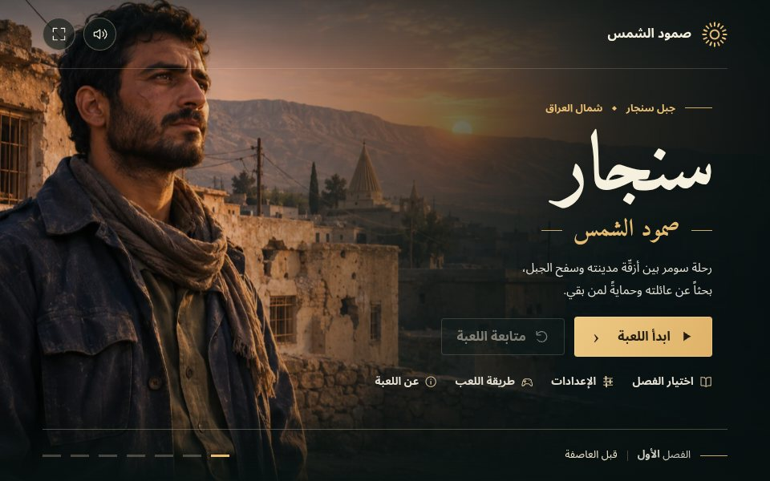
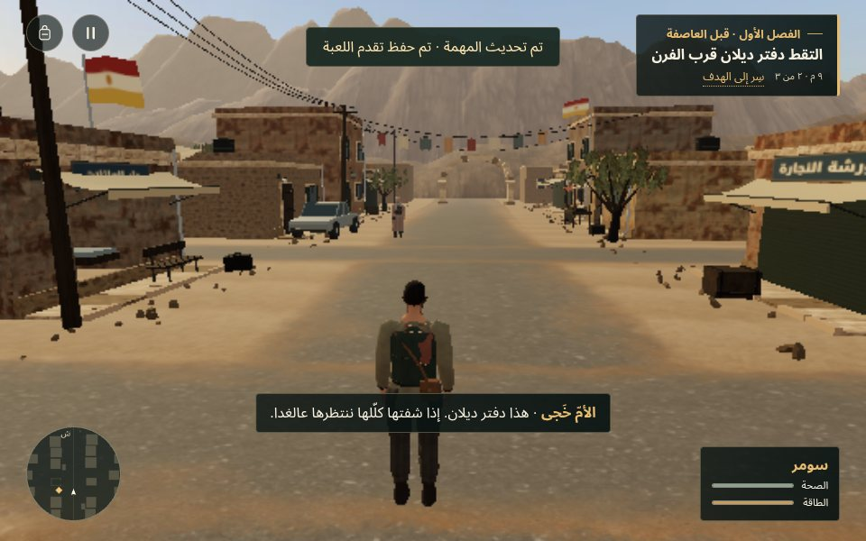
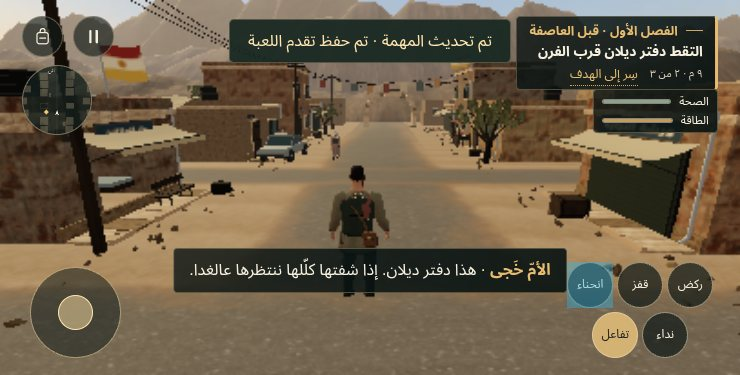

<div dir="rtl" lang="ar">

# سنجار – صمود الشمس

لعبة مغامرة ثلاثية الأبعاد بالعربية. العب بشخصية **سومر**، شاب إيزيدي يعود إلى حارات سنجار بحثاً عن عائلته. تتألف الحملة من سبعة فصول و٢١ مهمّة قصيرة. تتيح لك القصة جمع شهادات الأهالي، ومرافقة الناجين، وتوزيع الماء، وإعادة الضوء إلى الملجأ.

[العب في المتصفح](https://darweshshngale.github.io/Ezidi-game/) · [ملفات المشروع](https://github.com/DarweshShngale/Ezidi-game) · [حالة الاختبارات والنشر](https://github.com/DarweshShngale/Ezidi-game/actions/workflows/pages.yml)



## طريقة اللعب

اختر **ابدأ اللعبة** ثم **ادخل الفصل**. اتبع المعيّن الذهبي واقترب من الشخص أو الغرض، ثم اضغط زر التفاعل. زر **سِر إلى الهدف** في لوحة المهمة يختار ممراً صالحاً للمشي. يمكنك استعادة التحكّم اليدوي في أي لحظة. شغّل نداء المساندة لإبعاد خصم خيالي عن المدنيين. تُحفظ نقطة التقدم بعد كل مهمة على جهازك.

| الحركة | الكمبيوتر | الهاتف |
|---|---|---|
| التحرك والنظر | WASD، اسحب بالفأرة للنظر أو استخدم السهمين الأفقيين | عصا اليسار والسحب فوق المشهد |
| الركض، القفز، الانحناء | Shift، مسافة، C | أزرار مستقلة |
| التفاعل، نداء المساندة | E، Q | تفاعل، نداء |
| الحقيبة، الإيقاف، السير الموجّه | I، Esc، G | أيقونتا الحقيبة والإيقاف ولوحة المهمة |

من **الإعدادات** يمكنك تخصيص مواضع أزرار اللمس وحساسيتها، وتغيير المنظور، وجودة الرسوم، ومستوى الصوت، والترجمة. يمكن استخدام الماء لاستعادة الطاقة والضماد لاستعادة بعض الصحة. تتوافر قراءة الحوار إذا احتوى الجهاز على صوت عربي محلي. على الأجهزة الداعمة، استخدم خيار تثبيت التطبيق أو الإضافة إلى الشاشة الرئيسية بعد الزيارة الأولى. يحتاج اللعب دون اتصال إلى اكتمال تنزيل اللعبة مرة واحدة.

## الفصول

قبل العاصفة · المدينة تحت النار · الطريق إلى الجبل · المقاومة · أزقة سنجار · الأمل الأخير · عودة الشمس.

المدينة والشخصيات والمهمات خيالية. تستلهم القصة أثر الإبادة التي ارتكبها داعش بحقّ الإيزيديين عام ٢٠١٤. التخطيط من تأليف المشروع، والجداريات والرايات محفوظة من التلف. للأصول البصرية والصوتية بيان مصدر أدناه.

</div>

# Sinjar — Rise of the Sun

A compact, authored Arabic-language rescue adventure for WebGL 2 browsers. Seven linked chapters share an explorable fictional neighbourhood. Characters, the time of day, civilian shelters, supplies, the clinic, school lamps and rebuilding work change with the story.




## Local installation and production

Use Node.js 22.12 or newer, npm, and a browser with hardware-accelerated WebGL 2.

```sh
git clone https://github.com/DarweshShngale/Ezidi-game.git
cd Ezidi-game
npm ci
npm run dev
```

Open the address printed by Vite at **/Ezidi-game/**. For the release build, run the following commands.

```sh
npm run typecheck
npm run build
npm run preview
```

The build emits self-contained static files in `dist/`, including both animated GLBs, imagery, fonts, the physics runtime, manifest, service worker and a revision identifier in `version.json`. Serve the directory over HTTPS under `/Ezidi-game/`. Localhost also supports offline testing. The downloadable production archive contains the contents of this directory. Opening HTML directly with a file URL does not provide the necessary module or service worker environment.

## Automated checks and deployment

```sh
npx playwright install --with-deps chromium
npm test
```

Playwright serves the production build automatically. Build it first. Set `CHROMIUM_PATH` to use a system Chromium executable. Set `GAME_URL` to run against a deployment, using its full URL with the trailing slash. The full-campaign test walks all 21 objectives with the same guided navigation and interaction controls available to a player. The other tests use movement keys and simultaneous touchscreen contacts, reload a checkpoint and reopen gameplay offline.

On pushes to `main`, GitHub Actions installs the locked dependencies, checks TypeScript, builds, runs Playwright, uploads the production artifact and deploys it to the `github-pages` environment. The deployment job requests `pages: write` and `id-token: write`. Repository administrators can select **GitHub Actions** under **Settings → Pages → Build and deployment → Source**. The branch history also retains an independently contributed smaller game in `prototype/`.

## Implementation

| Area | Location |
|---|---|
| Arabic menus, cinematic plates, inventory, settings, progress | `src/main.ts`, `src/story.ts`, `src/save.ts` |
| Third-/first-person camera, Rapier capsule, AI, stamina, health, guidance | `src/engine.ts`, `src/path.ts` |
| Neighbourhood, mountains, seasonal light, destructible crates, doors, props | `src/world.ts`, `src/chapter-set.ts` |
| Skinned characters, expressions and twelve animation clips | `src/actors.ts`, `public/actors/`, `tools/actors/` |
| Procedural score, spatial footsteps and effects, local voice selection | `src/audio.ts` |
| Localisation, drag layout editor and touch inputs | `index.html`, `src/style.css`, `src/touch-layout.ts` |
| Installable offline build, browser tests, deployment | `scripts/offline.mjs`, `playwright.config.ts`, `.github/workflows/pages.yml` |

The menu loads before the 3D and physics modules. The environment batches static geometry by material and area, removes small geometric details at distance, uses instanced stone debris and the renderer's frustum culling. Four presets adjust shadows, particles and pixel density. A moving frame-rate estimate adjusts internal rendering resolution. Original woven character materials and reduced-size photographic WebP maps ship with the game. Progress and reference portraits remain on the device.

## Credits and verification

See the [asset and license index](docs/licenses.md), [character sources and authoring recipe](docs/actors.md), [world sources](docs/world.md), [illustration provenance](docs/art.md), [audio design](docs/audio.md) and [test notes](docs/testing.md).

The campaign uses a single district and a small recurring cast. Story sequences combine illustrated plates, brief in-engine camera moves and animated interactions. Speech uses local synthesis when available. A reference photo supplies a journal portrait and scarf colour. It does not reconstruct a face mesh. The renderer uses WebGL 2, standard shadow maps and layered atmospheric sprites. There is no WebGPU backend, full volumetric raymarching, real-time destruction of buildings, or recorded voice cast. Physical iOS, Galaxy, macOS and Windows device performance still requires on-device measurement.
